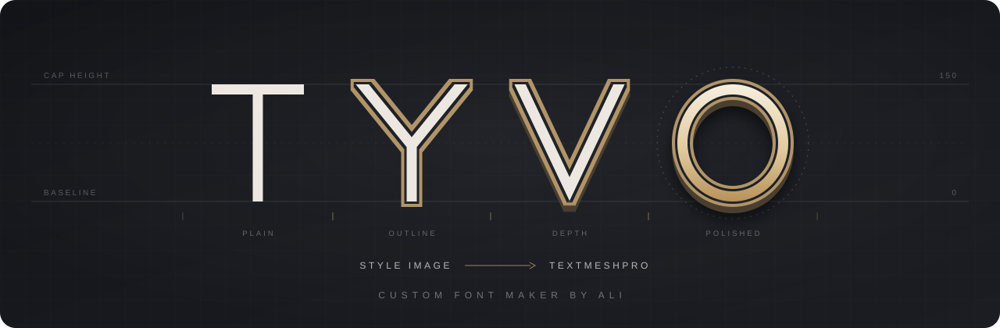

<p align="center">
  
</p>

# TYVO

*Custom font maker by Ali*

A Claude Code skill + Unity package that turns a reference image of styled text and a `.ttf`/`.otf` into a stylized TextMeshPro font: outline, rim, 3D extrude, gradient, shadow. Photoshop does the styling, Unity checks the result and renders a side-by-side against the reference.

- **Team guide (start here):** [GUIDE.md](GUIDE.md)
- **Skill instructions (for Claude):** [SKILL.md](SKILL.md)
- **Style format:** [reference/styles.md](reference/styles.md)
- **Troubleshooting:** [reference/troubleshooting.md](reference/troubleshooting.md)

## Quick install

```
python scripts/install_skill.py                                   # once per computer (adds the skill to Claude Code)
```

Project setup is automatic: the skill runs `scripts/bootstrap.ps1` (Windows) / `scripts/bootstrap.sh` (macOS) before its first command. It installs Python 3 only if missing, and the Unity package only if missing or out of date; anything already installed is skipped. To run it by hand:

```
powershell -NoProfile -ExecutionPolicy Bypass -File scripts/bootstrap.ps1 -Project "<Unity project>"
```

Requires Unity 6 (uGUI 2.0 / TextMeshPro) and Photoshop 2024+. Windows and macOS.

## Layout

| Path | What |
|---|---|
| `SKILL.md`, `GUIDE.md`, `reference/` | Instructions and docs |
| `scripts/tyvo.py` | CLI: analyze, generate, run, apply, check, render, compare, asl… |
| `scripts/install_skill.py` | Installs the skill into `~/.claude/skills/tyvo` |
| `scripts/bootstrap.ps1`, `scripts/bootstrap.sh` | Setup check: Python (only if missing) + Unity package (only if missing/out of date) |
| `package/app.tyvo.skill/` | Unity package: generator, checks, analyzer, compare, Photoshop scripts, style presets |
